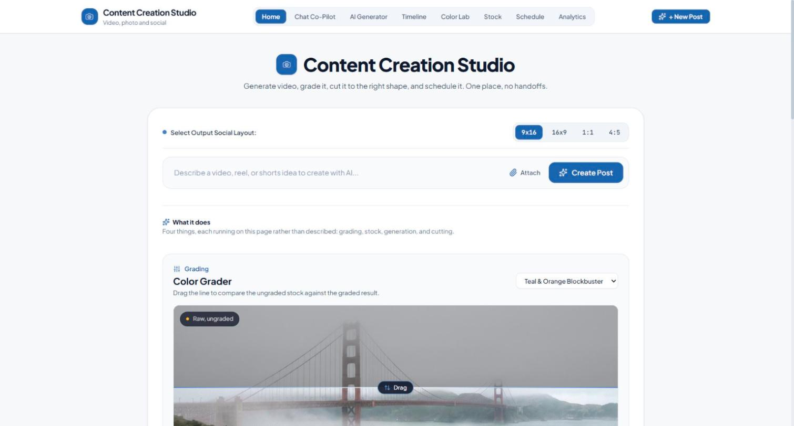
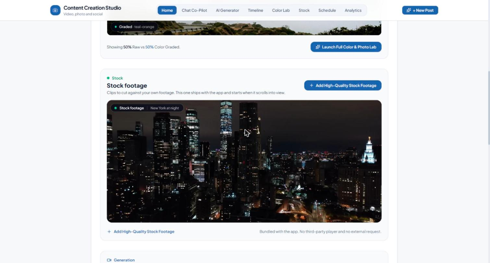
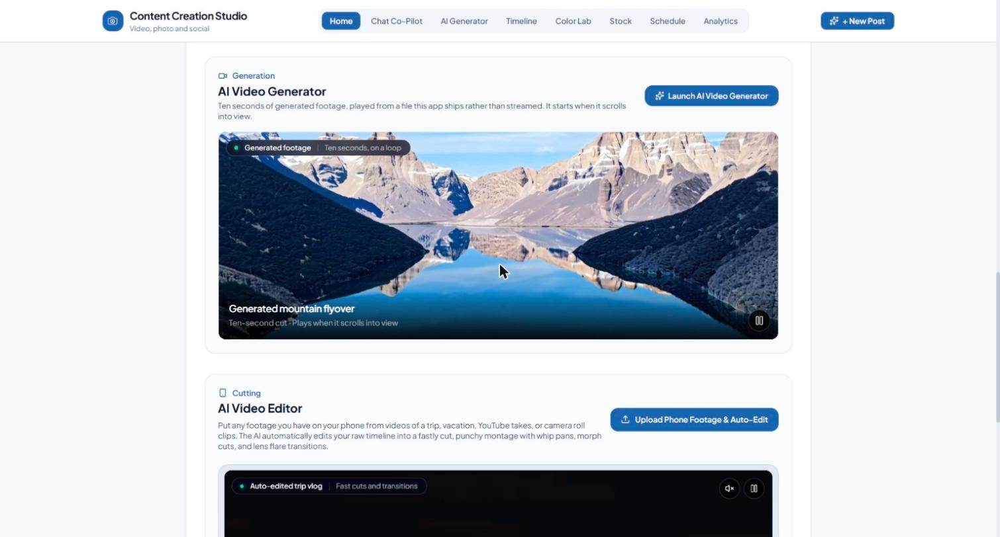

# Content Creation Studio

A workspace for making social video: generate a clip, grade it, cut it to the
right shape, and schedule it, without moving between four tools to do it.

**This is baseline architecture and layout for much larger client software
builds.** It is the starting point those builds are grown from, not a finished
product.

**The models and the integrations are not in this repository.** Nothing here
calls a generation API, uploads to a social platform, or reads an analytics
account. What is here is the structure those services plug into and the model
for how each step is presented.



## What this repository is

Baseline architecture and layout. The studio engine, the typed clip and
timeline model, the view structure and the design system here are the
foundation that much larger client software gets built on top of. What is in
this repository is the layer that does not change from one build to the next.

A client build keeps this core and adds what that organisation needs: a real
generation provider behind the prompt box, OAuth against the platforms it
posts to, server-side rendering and export, storage for footage, accounts and
roles, and real analytics in place of the sample figures. The way a clip is
modelled, cut and described stays as it is.

Read it as a structural reference, not as a product.

## What it does

Eight views over one project. The home page runs four of them live rather than
describing them, which is the part worth opening first.

| View | What it does |
| --- | --- |
| Home | The prompt box, the output shape, and four working demonstrations |
| Chat Co-Pilot | Conversational brief, turned into a clip plan |
| AI Generator | Prompt, reference matching, camera motion, aspect ratio |
| Timeline | Clips, transitions, scrubbing, timecode |
| Color Lab | LUT grading with a raw-versus-graded comparison |
| Stock | Footage browser, searchable, with an import field |
| Schedule | Per-platform posting times and queueing |
| Analytics | Retention, completion and reach, per platform |

### Grading, as a comparison rather than a claim

The Color Grader puts the ungraded stock against the graded result and lets you
drag the line between them. A grading tool that shows only the output is asking
to be believed; this one shows the input beside it.

### Stock, served from the app



The clip on the home page is a file this repository ships, not an embed. It was
a `youtube-nocookie` iframe, which put a third-party player inside the page and
made every visit a request to Google, to stream footage that was already on
disk. Nothing in the app now reaches an external host.

### Generation



The generated clip plays from `public/assets/videos` and starts when it scrolls
into view. The prompt box, reference matching and motion controls are all
wired through to the typed model; what is absent is a provider behind them.

## Architecture

React 19 and Tailwind 4 on Vite. No server, no database, no network call. State
lives in React and the sample data is a module.

### The studio engine

`src/utils/studioEngine.ts` holds the decisions, separated from the components
that render them: which transition suits a pair of clips, what a timeline's
duration is once transitions overlap, how a colour grade compiles to a CSS
filter, what a prompt implies about platform and aspect ratio.

Keeping those out of the components is what makes them testable without a
browser, which is why the test file covers them and nothing else.

### Types first

`src/types/studio.ts` and the exported interfaces in the engine define a clip, a
transition, a colour grade, a stock item and a scheduled post. The components
read those; none of them invents a shape of its own.

### One label for every video

`src/components/MediaLabel.tsx` is the label over every player. One component,
so the players cannot drift into four different chips. It takes a primary label,
an optional qualifier and a live indicator, and that is the whole API.

### The accent

Declared once in `src/index.css` as an OKLCH ramp at hue 252, overriding
Tailwind's palette rather than being applied per component. Contrast was
computed rather than eyeballed: white on the primary is 5.89:1, the primary on
the page is 5.53:1, and the light shade on the dark surface is 7.21:1.

## Running it

```bash
npm install
npm run dev
```

Opens on port 3000. `npm run lint` runs `tsc --noEmit` and `npm test` runs the
engine tests through Node's own runner.

## Honest status

This is a working build, not a shipped product. The gaps below are the ones a
client build closes.

- **No generation provider.** The prompt box, reference matching and motion
  controls are wired to the model and produce a plan; nothing calls an API. The
  clips shown are files in `public/assets/videos`.
- **No platform integrations.** Scheduling, posting and the analytics figures
  are sample data. There is no OAuth, no upload and no account anywhere in this
  repository.
- **The sample data is fictional.** `src/data/mockStudioData.ts` contains
  invented projects and figures. No real client, campaign or account is here.
- **Editing is in memory.** There is no persistence layer; a reload resets the
  project.
- **Tests cover the engine only.** Eight tests over `studioEngine.ts`, run with
  `node --test`. The components have none, and type checking is the only other
  automated gate.
- **Export is a dialogue, not an encoder.** The export modal collects the
  settings; no rendering happens.
- **The scaffold left traces.** This started from an AI Studio project.
  `metadata.json` declared a server-side Gemini capability and
  `.env.example` advertised an API key, neither of which anything read;
  both now say what is actually here. The `@google/genai` dependency and
  seven others that were declared and never imported are gone.

## Licence

No licence is granted. This repository is published so the architecture can be
read, not reused.
